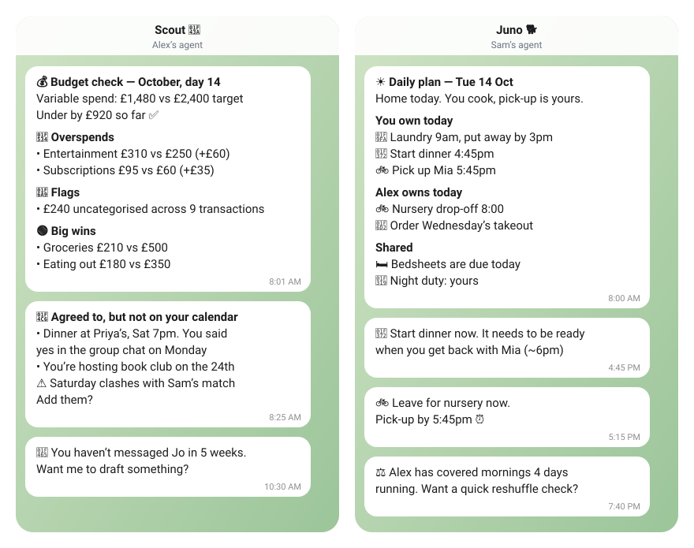

# OpenClaw Life OS

Two AI agents that run your household: one for you, one for your partner.

Each of you gets your own agent, with its own name, in your own chat. Each agent sees
only its person's calendar and inbox, plus the household context you share. Together
they handle the three things couples spend the most energy coordinating:

- **Chores, coordinated between you.** Every morning each partner gets their own plan:
  what you own today, what your partner owns, what is shared, with the hard times
  called out. Timed nudges arrive when it is time to start dinner or leave for
  pick-up. When the split drifts, the agent offers a reshuffle.
- **Budget, without opening a spreadsheet.** A plain-language report on where the
  month stands: what is over, what needs a look, and where you are winning.
- **Social calendar that keeps itself honest.** The agents read your email and chats
  for plans you said yes to, things you are hosting, and deadlines, then tell you
  what never made it onto the calendar and what clashes.



*Sample messages. The household above is fictional.*

A budget report looks like this:

```
💰 Budget check — October, day 14

Variable spend: £1,480 vs £2,400 target — under by £920 ✅

🔴 Overspends
• Entertainment: £310 vs £250 (+£60) — one £180 purchase may be miscategorised
• Subscriptions: £95 vs £60 (+£35)

🚩 Flags
• General (uncategorised): £240 across 9 transactions, worth reviewing

🟢 Big wins
• Groceries: £210 vs £500 — under by £290
• Eating out: £180 vs £350 — under by £170
```

Works solo too: onboarding skips the partner agent if you do not need one.

Built for OpenClaw and Claude Code. This repo is the blank version: structure,
skills, and templates, with no one's personal data in it.

## Quick start

```bash
git clone https://github.com/hosannafuller/openclaw-life-os.git
```

```bash
cd openclaw-life-os && claude
```

On first launch the agent sees that `USER.md` is missing and runs the **onboarding**
skill. It interviews you for about ten minutes and generates your personal files. If
it does not start by itself, type `/onboarding`.

Using OpenClaw: point a workspace at this folder. `AGENTS.md` and `BOOTSTRAP.md` send
the agent to the same onboarding skill.

## What you get

| Skill | What it does |
|-------|--------------|
| `/daily-plan` | Morning plan: calendar, today's household duties, due chores, budget pulse |
| `/fairplay-reshuffle` | Facilitates renegotiating who holds which responsibilities |
| `/schedule` | Reminders and recurring jobs |
| `date-scanner` | Finds dates you agreed to in email and chat that are not on the calendar |
| `social-commitment-scanner` | Same, for social plans and things you are hosting |
| `follow-up-chaser` | Emails where you are still waiting on a reply |
| `birthday-text-drafter` | Drafts birthday messages in your voice for approval |
| `relationship-maintenance` | Flags close friends you have not spoken to in weeks |
| `travel-prep` | Pre-departure brief the day before a trip |
| `travel-itinerary-builder` | One itinerary doc per trip, built from booking emails |
| `whatsapp-calendar` | React to a message to put it on the calendar |
| `budget-autocategorize` | Tidies uncategorised transactions |
| `system-health` | Tells you when auth, disk, or a background job has quietly broken |

## Layout

```
├── CLAUDE.md, AGENTS.md, SOUL.md    how the agent behaves
├── BOOTSTRAP.md, HEARTBEAT.md       first run, and what runs on each heartbeat
├── .claude/skills/                  the skills (also linked as skills/)
├── setup/templates/                 templates onboarding fills in
├── setup/integrations.md            connecting Google, Telegram, WhatsApp, iMessage
├── automations/                     cron and launchd templates
├── context-library/                 your profiles and household context (generated)
├── memory/                          operating rules and job state (generated)
├── outputs/                         daily plans and other output (generated)
└── templates/ sub-agents/ advanced/ agents/   empty slots for your own material
```

## Your data stays out of git

Onboarding writes only to paths listed in `.gitignore`: `USER.md`, `IDENTITY.md`,
`MEMORY.md`, `context-library/personal/`, `context-library/shared/`, `memory/`,
`outputs/`, and the rendered automation files. After onboarding, `git status` should
be clean. If you fork this repo, keep `.gitignore` as it is and check `git status`
before every push.

Secrets (OAuth clients, bot tokens, API keys) never belong in this folder at all.
See `setup/integrations.md`.

## Not included

- **Fair Play card names.** The household system here is based on *Fair Play* by Eve
  Rodsky. Bring your own deck, or list responsibilities in your own words.
- **Product-management skills, templates, and review sub-agents.** The original
  workspace also held a commercial PM skill pack. It is not redistributed here. The
  empty `templates/`, `sub-agents/`, and `advanced/` folders are where such material
  goes if you have your own.
- **Third-party tool skills** (Google Calendar, Slides). Install those from their
  own sources.
